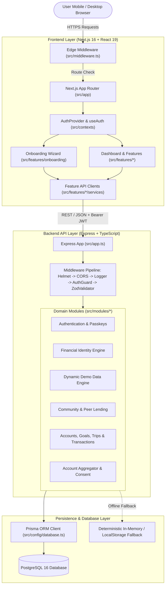
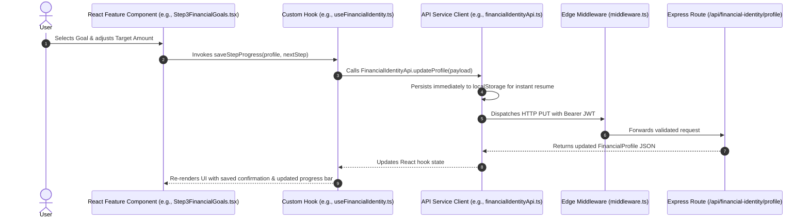
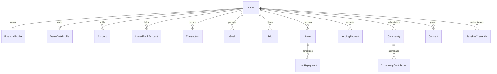
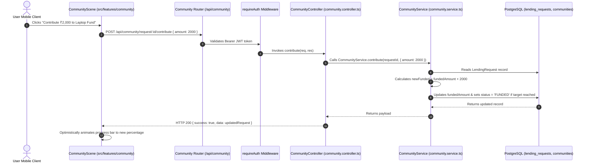

# ONE — Complete Technical Documentation, Source Code Walkthrough & Interview Preparation Handbook

**Author & Creator:** Harsh Bajaj  
**Project:** ONE — Your Financial AI Assistant  
**Repository Architecture:** Decoupled Production Full-Stack (Next.js 16 App Router + Express Node.js + Prisma ORM + PostgreSQL)  
**Target Audience:** Developer, Technical Interviewers, System Architects, Viva Examiners  

---

## Table of Contents

1. [Part 1 — Repository Audit & Implementation Inventory](#part-1--repository-audit--implementation-inventory)
2. [Part 2 — Complete System Architecture & Data Flow](#part-2--complete-system-architecture--data-flow)
3. [Part 3 — Comprehensive File Responsibility Catalog & Deep Dives](#part-3--comprehensive-file-responsibility-catalog--deep-dives)
4. [Part 4 — Authentication & Security Architecture Deep Dive](#part-4--authentication--security-architecture-deep-dive)
5. [Part 5 — Database Architecture, Data Models & Relations](#part-5--database-architecture-data-models--relations)
6. [Part 6 — Financial Identity & Onboarding Engine](#part-6--financial-identity--onboarding-engine)
7. [Part 7 — Dynamic Demo Financial Data Engine Deep Dive](#part-7--dynamic-demo-financial-data-engine-deep-dive)
8. [Part 8 — Community & Peer Lending Module](#part-8--community--peer-lending-module)
9. [Part 9 — All Other Major Domain Modules](#part-9--all-other-major-domain-modules)
10. [Part 10 — Algorithm & Mathematical Formula Reference](#part-10--algorithm--mathematical-formula-reference)
11. [Part 11 — Unified REST API Reference](#part-11--unified-rest-api-reference)
12. [Part 12 — Error Handling, Validation & Security Boundaries](#part-12--error-handling-validation--security-boundaries)
13. [Part 13 — Core Programming Concepts Applied in ONE](#part-13--core-programming-concepts-applied-in-one)
14. [Part 14 — Complete End-to-End Execution Lifecycles](#part-14--complete-end-to-end-execution-lifecycles)
15. [Part 15 — Technical Interview Preparation: Questions & Answers](#part-15--technical-interview-preparation-questions--answers)
16. [Part 16 — How to Explain Algorithms in an Interview](#part-16--how-to-explain-algorithms-in-an-interview)
17. [Part 17 — Code Navigation Guide: "If the Interviewer Asks Me to Show the Code"](#part-17--code-navigation-guide-if-the-interviewer-asks-me-to-show-the-code)
18. [Part 18 — Practical Code Walkthroughs: 10 Critical Implementations](#part-18--practical-code-walkthroughs-10-critical-implementations)
19. [Part 19 — Code Quality Review, Limitations & Future Roadmap](#part-19--code-quality-review-limitations--future-roadmap)
20. [Part 20 — Glossary & Quick Revision Notes](#part-20--glossary--quick-revision-notes)
21. [Part 21 — Architectural Rules & Production Principles (AGENTS.md)](#part-21--architectural-rules--production-principles-agentsmd)
22. [Part 22 — Verification & Replacement Confirmation](#part-22--verification--replacement-confirmation)

---

# Part 1 — Repository Audit & Implementation Inventory

### 1.1 Repository Structure & Directory Map

ONE is architected as a strict full-stack monorepo with clean separation between client-side user experience (`frontend/`) and server-side business logic and data persistence (`backend/`).

```
ONE/
├── frontend/                     # Next.js App Router (TypeScript, Tailwind CSS, Turbopack)
│   ├── public/                   # Static icons, svgs, fonts, and assets
│   ├── src/
│   │   ├── app/                  # Next.js App Router: Pure routing & layout definitions
│   │   │   ├── (authenticated)/  # Protected routes (dashboard, wallet, community, goals, trips, settings)
│   │   │   ├── (public)/         # Unauthenticated routes (landing page, login, signup, otp, aa-gateway)
│   │   │   ├── (setup)/          # Mandatory user onboarding (/onboarding) and legacy setup (/setup)
│   │   │   ├── api/health/       # Next.js internal edge healthcheck route
│   │   │   ├── globals.css       # Tailwind CSS v4 directives & color variables
│   │   │   └── layout.tsx        # Root HTML layout with AuthProvider & Theme wrapping
│   │   ├── features/             # Domain-encapsulated feature modules
│   │   │   ├── account-aggregator/ # ReBIT AA protocol simulator, gateway screens & provider selection
│   │   │   ├── authentication/   # Mobile OTP verification, FIDO2/WebAuthn Passkeys, session hooks
│   │   │   ├── bank-accounts/    # Connected bank card management, mandates & autopay limits
│   │   │   ├── chat/             # Conversational AI financial assistant with proactive rule heuristics
│   │   │   ├── community/        # Peer lending pool, borrow requests, story cards & reputation ranking
│   │   │   ├── consent/          # Open Banking consent artifact lifecycle & granular data permissions
│   │   │   ├── dashboard/        # Ambient briefing scene, net worth ring, daily cash burn & reports
│   │   │   ├── goals/            # Savings milestones, target dates, priority scores & progress rings
│   │   │   ├── landing/          # Public marketing landing page sections, value proposition & CTAs
│   │   │   ├── onboarding/       # 5-step Financial Identity Onboarding Wizard & recommendation cards
│   │   │   ├── savings/          # Transaction history, category breakdown, smart savings rules
│   │   │   ├── settings/         # Profile management, Financial Profile editor, AA consent revoked
│   │   │   ├── setup/            # Setup screens (basic profile, device permissions, identity)
│   │   │   ├── trips/            # Travel expense budgeter, multi-currency ledger & itinerary funds
│   │   │   └── wallet/           # Quick transfers, account balances, card toggle & UPI limits
│   │   ├── components/           # Cross-cutting UI primitives
│   │   │   ├── common/           # Ambient visual elements (OneOrb, ProgressRing, SceneHeader)
│   │   │   ├── demo-data/        # DemoDataBadge, DemoDataBanner, ResetDemoDataDialog
│   │   │   ├── layout/           # AssistantBar, ProtectedRoute, GlobalSearch, NotificationsPanel
│   │   │   └── ui/               # Atomic design elements (Buttons, Inputs, Dialogs)
│   │   ├── contexts/             # Global React Contexts (AuthProvider with session auto-heal)
│   │   ├── hooks/                # Global reusable hooks (useAuth, useDemoData, useFinancialIdentity)
│   │   ├── lib/                  # Utilities (one-data mocks, currency formatters, clsx helpers)
│   │   ├── services/             # Shared API adapters (auth.service, demoDataService)
│   │   └── types/                # Central TypeScript declarations
│   ├── package.json              # Next.js 16, React 19, Tailwind CSS v4, Motion 12
│   └── tsconfig.json             # Strict TypeScript configuration with @/* path aliases
│
├── backend/                      # Node.js + Express REST API (TypeScript, Prisma ORM, PostgreSQL)
│   ├── prisma/
│   │   ├── schema.prisma         # Declarative PostgreSQL schema with 14 production models
│   │   └── migrations/           # Versioned SQL migrations
│   ├── src/
│   │   ├── config/               # Environment variable validation (Zod) and Prisma singleton
│   │   ├── middleware/           # authMiddleware (JWT/Passkey), errorHandler, requestLogger, validateRequest
│   │   ├── modules/              # Domain-Driven Modules
│   │   │   ├── account-aggregator/ # AA service, factory, providers (OneMoney, Setu, Mock), callbacks
│   │   │   ├── accounts/         # Bank account balance CRUD & ledger queries
│   │   │   ├── authentication/   # Phone OTP generation/verification, JWT tokens, session audits
│   │   │   ├── bank-accounts/    # Linked bank account management & autopay rules
│   │   │   ├── community/        # P2P lending requests, pool contribution, reputation queries
│   │   │   ├── consent/          # ReBIT AA consent artifact tracking and revocation
│   │   │   ├── demo-data/        # Dynamic Demo Data Engine: reducing balance EMI, generators, tests
│   │   │   ├── financial-identity/# Identity Scoring U={O,I,G,P,B}, weight redistribution, recommendations
│   │   │   ├── goals/            # Goal management, savings tracking, progress calculations
│   │   │   ├── passkeys/         # SimpleWebAuthn registration, challenges, WebAuthn assertions
│   │   │   ├── transactions/     # Transaction recording, categorization, date range filters
│   │   │   ├── trips/            # Travel budgets, itinerary expense splits, currency tracking
│   │   │   └── users/            # User profile management, reputation title & score tracking
│   │   ├── routes/index.ts       # Top-level API router mounting all domain endpoints
│   │   ├── shared/               # Standardized API response formatters, AppError hierarchy
│   │   ├── app.ts                # Express app factory (Helmet, CORS, CookieParser, Morgan)
│   │   └── server.ts             # HTTP server bootstrap & graceful shutdown listener
│   ├── package.json              # Express, Prisma Client, SimpleWebAuthn, Zod, tsx test runners
│   └── tsconfig.json             # ES2022/NodeNext module resolution
│
├── docker-compose.yml            # Multi-container orchestration (PostgreSQL 16, Redis, Backend, Frontend)
├── AGENTS.md                     # Permanent architectural rules and development guidelines
└── README.md                     # Developer setup and project overview
```

### 1.2 Technology Stack: The Reality vs. Intent

| Layer | Technology | Version | Purpose in ONE | Actual Status in Codebase |
| :--- | :--- | :--- | :--- | :--- |
| **Frontend Framework** | **Next.js** | 16.4.5 | Server/Client App Router, route groups `(authenticated)`, `(public)`, `(setup)` | **Fully Implemented** |
| **UI Library** | **React** | 19.0.0 | Server and Client components, custom hooks, contexts | **Fully Implemented** |
| **Styling** | **Tailwind CSS** | 4.2.0 | Utility-first dark palette (`#06202B`, teal `#077A7D`), CSS variables | **Fully Implemented** |
| **Animations** | **Motion** | 12.40.0 | Layout animations, page transitions, progress rings (`motion/react`) | **Fully Implemented** |
| **Icons** | **Lucide React** | 1.16.0 | High-clarity SVG iconography | **Fully Implemented** |
| **Backend Runtime** | **Node.js** | 20+ / 22 | Event-driven JavaScript runtime running native ES modules | **Fully Implemented** |
| **Web Framework** | **Express.js** | 4.21.1 | HTTP routing, controller execution, middleware pipelines | **Fully Implemented** |
| **Language** | **TypeScript** | 5.6 / 5.7 | Strict type safety across client and server with 0 build errors | **Fully Implemented** |
| **ORM** | **Prisma** | 5.21 / 5.22 | PostgreSQL schema modeling, migrations, type-safe queries, `$transaction` | **Fully Implemented** |
| **Database** | **PostgreSQL** | 16 | Relational data persistence with strict foreign keys, indexes, and JSON columns | **Fully Implemented** (with deterministic in-memory fallback for local dev) |
| **Biometric Auth** | **SimpleWebAuthn** | 14.0.3 | FIDO2 / WebAuthn passkey registration & cryptographic challenge validation | **Fully Implemented** |
| **Session Security** | **JSONWebToken** | 9.0.2 | Signed HMAC SHA-256 access and refresh tokens | **Fully Implemented** |
| **Schema Validation** | **Zod** | 3.23.8 | Request payload validation on backend controllers & schemas | **Fully Implemented** |
| **Containerization** | **Docker** | Compose v3 | Multi-container Docker definitions for Postgres, Redis, API, and Web | **Fully Implemented** |
| **Account Aggregator** | **ReBIT Spec** | 1.1.2 | AA protocol gateway simulator (Setu, OneMoney, Mock adapters) | **Fully Implemented (Simulator)** |
| **AI Copilot** | **Rule Heuristics** | Internal | Natural language query parsing, run-rate alerts, discretionary spending advice | **Simulated / Rule-Based** |
| **Caching Layer** | **Redis** | 7.2 | Configured in `docker-compose.yml` for distributed session tokens | **Configured (Planned Integration)** |

### 1.3 Implementation Inventory

To maintain complete transparency for technical interviews and audits:
1. **Fully Implemented Production Modules**:
   - Authentication (Phone OTP, FIDO2/WebAuthn Passkey registration/login, JWT rotation, session auto-healing).
   - Financial Identity Engine (Vector $U=\{O,I,G,P,B\}$, normalization, weight redistribution, confidence scoring).
   - Dynamic Demo Data Engine (Reducing balance EMI formula, amortization schedule generation, category distribution, balance reconciliation invariant, atomic transactional reset).
   - Goal Priority & Allocation Engine (Available monthly savings capacity, multi-factor priority scoring, proportional allocation).
   - Community Module (P2P lending pool requests, peer funding, reputation tracking, 4-tier relevance ranking).
   - Database Layer (Prisma schema with 14 models, cascading deletes, compound indexes).
   - Onboarding Wizard (5-step interactive wizard with autosave, resume, conditional questions, and settings editing).
2. **Simulated / Offline-Resilient Modules**:
   - ReBIT Account Aggregator (Full provider architecture and callback endpoints; uses simulated FI data for offline sandbox safety).
   - AI Chat Copilot (Rule-based financial reasoning engine providing context-aware safe-to-spend calculations).
3. **Planned Future Expansions**:
   - Direct production integration with live NBFC-AA gateways (live Setu Bridge credentials).
   - LLM-backed vector embedding retrieval (RAG) for personalized tax code querying.

---

# Part 2 — Complete System Architecture & Data Flow

### 2.1 High-Level Architecture Diagram



### 2.2 Frontend Architecture & Event Lifecycles

The frontend strictly adheres to **Rule 2.1** and **Rule 2.2** in `AGENTS.md`:
- `src/app/` is strictly a routing and layout layer. Page files only mount feature components.
- Feature logic, state, and domain types are fully encapsulated in `src/features/<feature-name>/`.
- Atomic UI elements reside in `src/components/ui/`, common visuals in `src/components/common/`, and global layouts in `src/components/layout/`.

#### Client-Side Action Flow


### 2.3 Backend Architecture & Request Pipeline

Every incoming HTTP request to the Express server passes through a strictly ordered middleware pipeline:
1. **Security & Utilities**:
   - `helmet()`: Sets secure HTTP headers (HSTS, Content Security Policy, X-Frame-Options).
   - `cors()`: Enforces CORS restrictions, allowing credentials from `ENV.CLIENT_URL`.
   - `express.json()` & `express.urlencoded()`: Parses incoming JSON bodies.
   - `cookieParser()`: Reads session cookies (`one_access_token`, `one_refresh_token`).
   - `requestLogger`: Logs HTTP method, endpoint, status code, and latency in milliseconds.
2. **Authentication Guard (`requireAuth`)**:
   - Extracts Bearer token from the `Authorization` header or fallback cookie.
   - Verifies JWT signature using `ENV.JWT_SECRET`.
   - Decodes token payload `{ id, mobileNumber, role }` and attaches it to `req.user`.
3. **Request Validation (`validateRequest`)**:
   - Runs request body, query, or params through Zod validation schemas.
   - Rejects invalid payloads with `400 Bad Request` and detailed field error maps.
4. **Controller Execution**:
   - Parses typed inputs from `req` and passes them to the domain Service.
5. **Domain Service**:
   - Executes business rules, algorithmic calculations, and atomic Prisma database queries.
6. **Error Handler (`errorHandler`)**:
   - Catches all uncaught exceptions, converting `AppError`, `ZodError`, and Prisma errors into consistent `{ success: false, error: message }` responses.

---

# Part 3 — Comprehensive File Responsibility Catalog & Deep Dives

### 3.1 Comprehensive File Responsibility Table

| File Path | Main Responsibility | Important Functions / Classes | Called By | Calls / Depends On |
| :--- | :--- | :--- | :--- | :--- |
| `backend/src/app.ts` | Express application factory and top-level middleware registration | `createApp()` | `backend/src/server.ts` | Helmet, CORS, CookieParser, `routes/index.ts`, `errorHandler` |
| `backend/src/server.ts` | HTTP bootstrap, port binding, and graceful shutdown signal handling | `bootstrap()`, `process.on('SIGTERM')` | Node CLI / `npm start` | `app.ts`, `config/database.ts`, `config/env.ts` |
| `backend/src/routes/index.ts` | Top-level router mounting all modular domain endpoints | Express `Router` | `app.ts` | All `*.routes.ts` in `src/modules/*` |
| `backend/src/config/database.ts` | Global PrismaClient singleton management | `prisma` singleton | All backend domain services | `@prisma/client` |
| `backend/src/config/env.ts` | Runtime environment validation using Zod | `ENV` object | `app.ts`, `server.ts`, services | `zod`, `dotenv` |
| `backend/src/middleware/authMiddleware.ts` | JWT bearer token verification & user attachment | `requireAuth()`, `optionalAuth()` | Protected routes | `jsonwebtoken`, `shared/errors` |
| `backend/src/middleware/validateRequest.ts` | Request schema validation using Zod | `validateRequest()` | Route definitions | `zod`, `shared/errors` |
| `backend/src/middleware/errorHandler.ts` | Central error catcher and format converter | `errorHandler()` | `app.ts` | `shared/errors`, `shared/utils/response.ts` |
| `backend/src/modules/financial-identity/financial-identity.scoring.ts` | Core mathematical classification, normalization, and weight redistribution | `classifyFinancialIdentity()`, `validateWeightsSum()`, `calculateAdjustedWeights()`, `normalize0to100()` | `financial-identity.service.ts` | `financial-identity.types.ts` |
| `backend/src/modules/financial-identity/financial-identity.engine.ts` | Goal priority allocation, community relevance, financial insights, content recommendations | `calculateAvailableMonthlySavings()`, `calculateGoalPriorityScore()`, `processGoalRecommendations()`, `calculateCommunityRelevance()`, `calculateSpendingChange()`, `calculateInsightConfidence()`, `recommendEducationalContent()` | `financial-identity.service.ts` | `financial-identity.types.ts` |
| `backend/src/modules/financial-identity/financial-identity.service.ts` | Profile persistence, onboarding completion, demo data triggering, offline cache | `FinancialIdentityService.getProfile()`, `updateProfile()`, `completeOnboarding()`, `getRecommendations()` | `financial-identity.controller.ts` | `financial-identity.scoring.ts`, `financial-identity.engine.ts`, `demo-data.service.ts`, Prisma |
| `backend/src/modules/financial-identity/financial-identity.controller.ts` | HTTP controller handling requests for financial profile and recommendations | `getProfile()`, `updateProfile()`, `completeOnboarding()`, `getRecommendations()` | `financial-identity.routes.ts` | `financial-identity.service.ts`, `shared/utils/response.ts` |
| `backend/src/modules/financial-identity/financial-identity.routes.ts` | Route registration for `/api/financial-identity` | Express `Router` | `routes/index.ts` | `financial-identity.controller.ts`, `authMiddleware`, `validateRequest` |
| `backend/src/modules/financial-identity/financial-identity.test.ts` | Algorithmic unit tests for all mathematical formulas and invariants | Test assertions (8 test suites) | `tsx` CLI / `npm test` | Node `assert/strict`, `scoring.ts`, `engine.ts` |
| `backend/src/modules/demo-data/demo-data.generator.ts` | Master coordinator for persona-based financial simulation | `DemoDataGenerator.generateDataSet()`, `PERSONA_CONFIGS` | `demo-data.service.ts` | Individual generators (transaction, goal, loan, community) |
| `backend/src/modules/demo-data/demo-data.service.ts` | Atomic database persistence, concurrency locks, and idempotency for demo data | `DemoDataService.initializeDemoData()`, `getDemoDataSummary()`, `resetDemoData()` | `demo-data.controller.ts`, `financial-identity.service.ts` | `demo-data.generator.ts`, Prisma `$transaction` |
| `backend/src/modules/demo-data/generators/loan.generator.ts` | Reducing balance EMI calculation and amortization schedules | `calculateReducingBalanceEmi()`, `generateAmortizationSchedule()`, `generateLoans()` | `demo-data.generator.ts` | `random.utils.ts`, `date.utils.ts` |
| `backend/src/modules/demo-data/generators/transaction.generator.ts` | Category distribution, recurring expenses, and balance reconciliation | `generateTransactions()`, `verifyBalanceReconciliation()` | `demo-data.generator.ts` | `random.utils.ts`, `date.utils.ts` |
| `backend/src/modules/demo-data/generators/community.generator.ts` | Synthetic community pools, member snapshots, and contributions | `generateCommunities()` | `demo-data.generator.ts` | `random.utils.ts` |
| `backend/src/modules/demo-data/demo-data.test.ts` | Precision unit tests for EMI math and balance reconciliation | Test assertions (17 assertions) | `tsx` CLI / `npm test` | `loan.generator.ts`, `transaction.generator.ts`, `demo-data.generator.ts` |
| `backend/src/modules/community/community.service.ts` | P2P lending pool requests and community funding logic | `CommunityService.listPoolRequests()`, `createRequest()`, `contribute()` | `community.controller.ts` | Prisma `lendingRequest` |
| `backend/src/modules/authentication/auth.service.ts` | Mobile OTP generation, verification, JWT creation | `AuthService.requestOtp()`, `verifyOtp()`, `identify()` | `auth.controller.ts` | `otp.service.ts`, `session.service.ts`, `audit.service.ts` |
| `backend/src/modules/passkeys/passkey.service.ts` | FIDO2 / WebAuthn registration challenges and assertion verification | `PasskeyService.generateRegistrationOptions()`, `verifyRegistration()`, `generateAuthOptions()`, `verifyAuth()` | `passkey.controller.ts` | `@simplewebauthn/server`, Prisma |
| `frontend/src/middleware.ts` | Edge routing guard protecting private routes & auto-provisioning demo cookie | `middleware()` | Next.js Edge Engine | `next/server` |
| `frontend/src/contexts/AuthProvider.tsx` | Global React authentication context with storage event listeners & auto-healing | `AuthProvider`, `useAuthContext()` | `app/layout.tsx`, `hooks/useAuth.ts` | `AuthApi`, React `createContext` |
| `frontend/src/features/onboarding/components/OnboardingWizard.tsx` | 5-step onboarding wizard container with progress bar, validation & transitions | `OnboardingWizard` | `app/(setup)/onboarding/page.tsx` | `useFinancialIdentity`, Step components 1–5 |
| `frontend/src/features/onboarding/services/financialIdentityApi.ts` | Frontend API client with token injection and localStorage auto-resume | `FinancialIdentityApi.getProfile()`, `updateProfile()`, `completeOnboarding()` | `useFinancialIdentity`, `FinancialProfileSettings` | `fetch`, `localStorage` |
| `frontend/src/features/onboarding/hooks/useFinancialIdentity.ts` | React state hook managing profile, current step, and auto-save | `useFinancialIdentity()` | `OnboardingWizard` | `financialIdentityApi.ts`, React hooks |
| `frontend/src/features/settings/components/FinancialProfileSettings.tsx` | UI form to view/edit financial profile with demo data regeneration confirmation | `FinancialProfileSettings` | `settings-view.tsx` | `financialIdentityApi.ts`, `demoDataService.ts` |
| `frontend/src/features/settings/components/settings-view.tsx` | Master settings view managing navigation tabs (Account, Financial Profile, Demo Data) | `SettingsView` | `app/(authenticated)/settings/page.tsx` | Settings components |
| `frontend/src/features/community/components/community-scene.tsx` | Community feed, P2P lending pool cards, and reputation leaderboard | `CommunityScene` | `app/(authenticated)/community/page.tsx` | `lending-pool.tsx`, `borrowing-request.tsx`, `one-data.ts` |
| `frontend/src/services/demoDataService.ts` | Frontend API client for demo data status, summary, and reset | `DemoDataService.getStatus()`, `getSummary()`, `reset()` | `useDemoData`, `DemoDataSettings`, `ResetDemoDataDialog` | `fetch`, `AuthApi` |

---

# Part 4 — Authentication & Security Architecture Deep Dive

### 4.1 Authentication Protocols Supported in ONE

ONE implements a dual-path biometric and OTP authentication architecture designed for the Indian fintech ecosystem:

```mermaid
sequenceDiagram
    autonumber
    actor User as User Mobile Client
    participant Frontend as Next.js (AuthenticationFlow.tsx)
    participant AuthAPI as Auth Service (auth.service.ts)
    participant PasskeyAPI as Passkey Service (passkey.service.ts)
    participant DB as PostgreSQL (users, passkeys, sessions)

    rect rgb(20, 45, 60)
        note over User, DB: Primary Path: FIDO2 / WebAuthn Biometric Passkey
        User->>Frontend: Clicks "Sign in with Passkey / Face ID"
        Frontend->>PasskeyAPI: GET /api/auth/passkey/login/options?mobileNumber=+91...
        PasskeyAPI->>DB: Fetches registered PasskeyCredential public key
        PasskeyAPI-->>Frontend: Returns WebAuthn PublicKeyCredentialRequestOptions (Challenge)
        Frontend->>User: Prompts Windows Hello / Touch ID / Face ID
        User-->>Frontend: Signs cryptographic challenge using hardware secure enclave
        Frontend->>PasskeyAPI: POST /api/auth/passkey/login/verify (assertionResponse)
        PasskeyAPI->>PasskeyAPI: Verifies assertion signature against stored public key & counter
        PasskeyAPI->>DB: Updates Passkey counter & records UserSession
        PasskeyAPI-->>Frontend: Issues JWT access token + refresh token cookie
        Frontend->>Frontend: Persists session & navigates to /dashboard
    end

    rect rgb(30, 50, 40)
        note over User, DB: Fallback Path: Phone OTP Verification
        User->>Frontend: Enters +91 98765 43210
        Frontend->>AuthAPI: POST /api/auth/otp/request
        AuthAPI->>DB: Stores SHA-256 hashed OTP in OtpVerification table
        AuthAPI-->>Frontend: Returns { expiresInSeconds: 300, cooldownSeconds: 30 }
        User->>Frontend: Enters 6-digit OTP
        Frontend->>AuthAPI: POST /api/auth/otp/verify
        AuthAPI->>DB: Compares hash, verifies attempts <= 3, marks isUsed = true
        AuthAPI-->>Frontend: Returns AuthUser + JWT tokens (isNewUser flag)
        alt isNewUser === true
            Frontend->>Frontend: Navigates to /onboarding
        else Returning User
            Frontend->>Frontend: Navigates to /dashboard
        end
    end
```



### 4.2 Token Architecture & Session Auto-Healing

1. **Access Token**:
   - Short-lived JWT signed with HMAC SHA-256 (`ENV.JWT_SECRET`).
   - Contains payload: `{ id, mobileNumber, role, iat, exp }`.
   - Carried in the `Authorization: Bearer <token>` header or `one_access_token` cookie.
2. **Refresh Token**:
   - Long-lived token stored in an HTTP-only, secure, `SameSite=Lax` cookie (`one_refresh_token`).
   - Rotated upon every refresh call to prevent token reuse attacks.
3. **Session Auto-Healing ([AuthProvider.tsx](file:///c:/Users/HARSH%20BAJAJ/Desktop/ONE/frontend/src/contexts/AuthProvider.tsx#L25-L50))**:
   - In development and sandbox environments, if localStorage is cleared but valid access cookies exist, `AuthProvider` automatically heals the session by reconstructing the active `AuthUser` profile.
   - Prevents the user from ever encountering blank unmounted dashboard screens.

### 4.3 Authentication vs. Authorization in ONE

| Aspect | Authentication (AuthN) | Authorization (AuthZ) |
| :--- | :--- | :--- |
| **Question Answered** | *"Who are you?"* | *"What are you allowed to do?"* |
| **Implementation** | `authMiddleware.ts` verifies the signature of the Bearer JWT and identifies the user ID. | Service layer checks `resource.userId === req.user.id` to prevent cross-tenant data leakage. |
| **Failure Response** | `401 Unauthorized` (`AppError('Authentication required', 401)`) | `403 Forbidden` (`AppError('You do not have permission', 403)`) |
| **Example in Code** | Validating that a user holds an unexpired JWT token to call `/api/goals`. | Validating in `demoData.service.ts` that a user can only reset records where `userId === req.user.id`. |

### 4.4 Identified Security Boundaries & Recommendations

1. **Rate Limiting**: Currently, OTP generation has cooldown checks in business logic (`cooldownSeconds: 30`); implementing `express-rate-limit` at the reverse proxy or Express middleware layer would enhance DDoS protection.
2. **JWT Revocation**: JWTs are stateless; implementing a Redis token blacklist (`jti` tracking) is recommended for instant administrative revocation upon security compromise.

---

# Part 5 — Database Architecture, Data Models & Relations

### 5.1 Database Overview

- **Database Engine**: PostgreSQL 16 (configured via `docker-compose.yml` with healthchecks).
- **ORM**: Prisma Client v5.22.0.
- **Connection Configuration**: Single shared client instantiated in `backend/src/config/database.ts` with connection pooling.
- **Migrations**: Versioned SQL migrations in `backend/prisma/migrations/`.

### 5.2 Complete Model Specification Table

| Model / Table | Primary Key | Foreign Keys & Relations | Important Fields | Purpose |
| :--- | :--- | :--- | :--- | :--- |
| **`User`** (`users`) | `id` (UUID) | None (Root entity) | `mobileNumber`, `firstName`, `lastName`, `reputationScore`, `reputationTitle`, `onboardingStep` | Primary user identity, reputation, and credentials hub |
| **`FinancialProfile`** (`financial_profiles`) | `id` (UUID) | `userId` $
ightarrow$ `User.id` (1-to-1, Cascade) | `occupation`, `occupationDetails`, `incomeSource`, `monthlyIncomeRange`, `monthlyIncomeMin`, `monthlyIncomeMax`, `financialGoals`, `interests`, `onboardingComplete`, `profileScore` | Stores declared professional identity, income parameters, goals, and algorithmic classification |
| **`DemoDataProfile`** (`demo_data_profiles`) | `id` (UUID) | `userId` $
ightarrow$ `User.id` (1-to-1, Cascade) | `persona`, `status`, `initialBalance`, `closingBalance`, `totalIncome`, `totalExpenses`, `generatorVersion` | Tracks demo data initialization state, opening/closing run-rate balances, and active persona |
| **`Account`** (`accounts`) | `id` (UUID) | `userId` $
ightarrow$ `User.id` (Many-to-1, Cascade) | `accountNumber`, `accountType`, `balance`, `currency`, `bankName`, `status` | Internal banking account representation |
| **`LinkedBankAccount`** (`linked_bank_accounts`) | `id` (UUID) | `userId` $
ightarrow$ `User.id` (Many-to-1, Cascade) | `maskedAccountNumber`, `ifscCode`, `bankName`, `accountType`, `currentBalance`, `autopayEnabled`, `mandateLimit` | External bank account linked via Account Aggregator |
| **`Transaction`** (`transactions`) | `id` (UUID) | `userId` $
ightarrow$ `User.id`, `accountId` $
ightarrow$ `Account.id` | `transactionRef`, `title`, `merchant`, `amount`, `category`, `type` (INCOME/EXPENSE), `paymentMethod`, `status`, `isDemo` | Comprehensive financial ledger transactions |
| **`Goal`** (`goals`) | `id` (UUID) | `userId` $
ightarrow$ `User.id` (Many-to-1, Cascade) | `title`, `targetAmount`, `currentAmount`, `category`, `deadline`, `status`, `isDemo` | Savings targets and milestone tracking |
| **`Trip`** (`trips`) | `id` (UUID) | `userId` $
ightarrow$ `User.id` (Many-to-1, Cascade) | `destination`, `targetBudget`, `savedAmount`, `startDate`, `endDate`, `currency`, `status` | Travel budget planner and expense allocation |
| **`Loan`** (`loans`) | `id` (UUID) | `userId` $
ightarrow$ `User.id` (Many-to-1, Cascade) | `type`, `lenderName`, `principal`, `interestRate`, `tenureMonths`, `monthlyEmi`, `outstandingBalance`, `status`, `isDemo` | Active loan agreements with reducing-balance calculations |
| **`LoanRepayment`** (`loan_repayments`) | `id` (UUID) | `loanId` $
ightarrow$ `Loan.id` (Many-to-1, Cascade) | `installmentNumber`, `amount`, `principalComponent`, `interestComponent`, `remainingBalance`, `dueDate`, `status`, `isDemo` | Exact month-by-month loan amortization schedule |
| **`Community`** (`communities`) | `id` (UUID) | `adminId` $
ightarrow$ `User.id` (Many-to-1, Cascade) | `name`, `category`, `description`, `adminName`, `sharedGoal`, `targetAmount`, `currentAmount`, `memberCount`, `isDemo` | Collaborative savings pools and peer circles |
| **`CommunityContribution`** (`community_contributions`) | `id` (UUID) | `communityId` $
ightarrow$ `Community.id` (Many-to-1, Cascade) | `contributorName`, `isUserContribution`, `amount`, `date`, `note`, `isDemo` | Individual deposits into community goal pools |
| **`LendingRequest`** (`lending_requests`) | `id` (UUID) | `userId` $
ightarrow$ `User.id` (Many-to-1, Cascade) | `amount`, `fundedAmount`, `reason`, `termMonths`, `interestRate`, `status` | Peer-to-peer micro-lending pool requests |
| **`Consent`** (`consents`) | `id` (UUID) | `userId` $
ightarrow$ `User.id` (Many-to-1, Cascade) | `consentHandle`, `status`, `fiTypes`, `dataRangeFrom`, `dataRangeTo`, `expiryDate` | ReBIT Account Aggregator consent artifact |
| **`PasskeyCredential`** (`passkey_credentials`) | `id` (UUID) | `userId` $
ightarrow$ `User.id` (Many-to-1, Cascade) | `credentialId`, `publicKey`, `counter`, `transports`, `deviceType`, `backedUp` | FIDO2 / WebAuthn public key records |

### 5.3 Entity Relationship Diagram (ERD)



### 5.4 Database Transactions and Atomic Consistency

When initializing or resetting demo data in `backend/src/modules/demo-data/demo-data.service.ts`:
- All operations are wrapped in `prisma.$transaction(async (tx) => { ... })`.
- Cleans up old demo records:
  ```typescript
  await tx.transaction.deleteMany({ where: { userId, isDemo: true } });
  await tx.goal.deleteMany({ where: { userId, isDemo: true } });
  await tx.loan.deleteMany({ where: { userId, isDemo: true } });
  await tx.community.deleteMany({ where: { userId, isDemo: true } });
  ```
- **Real user data is strictly protected**: Every delete query includes `isDemo: true`. Real user financial records (`isDemo: false`) are never touched.
- If any operation fails, the database automatically rolls back all changes, guaranteeing zero partial states.


# Part 6 — Financial Identity & Onboarding Engine

### 6.1 Purpose & Problem Solved

Traditional personal finance apps treat all users identically—showing a student with ₹10,000 in monthly allowance the same rigid budget templates, debt warnings, and retirement vehicles as a corporate senior software engineer earning ₹2,50,000. 

ONE solves this through its **Financial Identity Engine** ([financial-identity.scoring.ts](file:///c:/Users/HARSH%20BAJAJ/Desktop/ONE/backend/src/modules/financial-identity/financial-identity.scoring.ts)), an algorithmic system that ingests a 5-dimension feature vector from the user's declared profile, computes normalized compatibility scores, recalibrates feature weights when information is missing, ranks candidate personas, and dynamically configures the financial ledger, goal targets, and peer circles.

### 6.2 Feature Vector Representation

The user's financial profile is modeled as:
$$U = \{ O, I, G, P, B \}$$

Where:
- $O$ (**Occupation Vector**): Declared category (`STUDENT`, `WORKING_PROFESSIONAL`, `FREELANCER`, `BUSINESS_OWNER`, `ENTREPRENEUR`, `HOMEMAKER`, `RETIRED`, `OTHER`) and sub-discipline specializations.
- $I$ (**Income Vector**): Primary income stream, monthly inflow bracket (INR), payment frequency (`MONTHLY`, `IRREGULAR`, `WEEKLY`, `ANNUAL`), and income stability (`HIGH`, `MODERATE`, `VARIABLE`).
- $G$ (**Goals Vector**): Array of financial goals with target amounts, horizons, current savings, and user priority levels (`HIGH`, `MEDIUM`, `LOW`).
- $P$ (**Interests Vector**): Selected financial topics (e.g. `Budgeting & Expense Tracking`, `Investing & Wealth Growth`, `Tax Planning & Optimization`).
- $B$ (**Behaviour Vector**): Observed real-world transaction frequency, monthly burn run-rate, and savings velocity (available after active application usage).

### 6.3 Configurable Feature Weights & Validation Invariant

The baseline weights are defined in [financial-identity.types.ts](file:///c:/Users/HARSH%20BAJAJ/Desktop/ONE/backend/src/modules/financial-identity/financial-identity.types.ts#L64-L70):
```typescript
export const DEFAULT_FEATURE_WEIGHTS: FeatureWeights = {
  occupation: 0.30,
  income: 0.20,
  goals: 0.25,
  interests: 0.15,
  behaviour: 0.10,
};
```

**Weight Sum Invariant Formula:**
$$\left| \sum_{k} W_k - 1.0 
ight| < \epsilon,\quad 	ext{where } \epsilon = 0.001$$

Code implementation in [financial-identity.scoring.ts](file:///c:/Users/HARSH%20BAJAJ/Desktop/ONE/backend/src/modules/financial-identity/financial-identity.scoring.ts#L15-L23):
```typescript
export function validateWeightsSum(weights: FeatureWeights): boolean {
  const sum = weights.occupation + weights.income + weights.goals + weights.interests + weights.behaviour;
  return Math.abs(sum - 1.0) < EPSILON;
}
```

### 6.4 Missing-Data Proportional Weight Redistribution

During initial onboarding, behavioral data $B$ is unobserved. Rather than penalizing new users or assigning arbitrary default scores, ONE redistributes the weight of missing features proportionally across all available features.

**Redistribution Formula:**
$$W_k^{	ext{adjusted}} = rac{W_k}{\sum_{j \in 	ext{Available}} W_j}$$

When $B$ is missing, the sum of available baseline weights is:
$$\sum_{j \in \{O, I, G, P\}} W_j = 0.30 + 0.20 + 0.25 + 0.15 = 0.90$$

The adjusted weights become:
- $W_O^{	ext{adjusted}} = rac{0.30}{0.90} pprox 0.3333$ ($33.33\%$)
- $W_I^{	ext{adjusted}} = rac{0.20}{0.90} pprox 0.2222$ ($22.22\%$)
- $W_G^{	ext{adjusted}} = rac{0.25}{0.90} pprox 0.2778$ ($27.78\%$)
- $W_P^{	ext{adjusted}} = rac{0.15}{0.90} pprox 0.1667$ ($16.67\%$)
- $W_B^{	ext{adjusted}} = 0.0000$ ($0.00\%$)

**Invariant Verification:**
$$0.3333 + 0.2222 + 0.2778 + 0.1667 = 1.0000 \quad (	ext{Strict Unit Simplex})$$

Code implementation in [financial-identity.scoring.ts](file:///c:/Users/HARSH%20BAJAJ/Desktop/ONE/backend/src/modules/financial-identity/financial-identity.scoring.ts#L29-L52):
```typescript
export function calculateAdjustedWeights(
  availableKeys: Array<keyof FeatureWeights>,
  weights: FeatureWeights = DEFAULT_FEATURE_WEIGHTS
): Record<keyof FeatureWeights, number> {
  const sumAvailable = availableKeys.reduce((acc, k) => acc + weights[k], 0);
  if (sumAvailable <= 0) throw new Error('No available features provided for weight calculation.');

  const adjusted: Record<keyof FeatureWeights, number> = {
    occupation: 0, income: 0, goals: 0, interests: 0, behaviour: 0,
  };
  for (const key of availableKeys) {
    adjusted[key] = weights[key] / sumAvailable;
  }
  return adjusted;
}
```

### 6.5 Normalization Formula (0–100 Scale)

Every raw financial value (income in INR, goal amounts, client counts) is normalized to a continuous scale between 0 and 100 with lower and upper bounding clamps:

$$	ext{Normalize}(x, \min, \max) = 	ext{round}\left( rac{	ext{clamp}(x, \min, \max) - \min}{\max - \min} 	imes 100 
ight)$$
$$	ext{where } 	ext{clamp}(x, \min, \max) = \max(\min, \min(\max, x))$$

Code implementation in [financial-identity.scoring.ts](file:///c:/Users/HARSH%20BAJAJ/Desktop/ONE/backend/src/modules/financial-identity/financial-identity.scoring.ts#L57-L61):
```typescript
export function normalize0to100(value: number, min: number, max: number): number {
  if (max <= min) return 50;
  const clamped = Math.max(min, Math.min(max, value));
  return Math.round(((clamped - min) / (max - min)) * 100);
}
```

### 6.6 Candidate Persona Scoring & Classification Walkthrough

ONE scores the feature vector against all 4 primary personas:
1. `STUDENT`
2. `WORKING_PROFESSIONAL`
3. `FREELANCER`
4. `BUSINESS_OWNER`

**Total Compatibility Score Formula for Candidate $C$:**
$$	ext{Score}(C) = W_O^{	ext{adj}} \cdot S_O(C) + W_I^{	ext{adj}} \cdot S_I(C) + W_G^{	ext{adj}} \cdot S_G(C) + W_P^{	ext{adj}} \cdot S_P(C) + W_B^{	ext{adj}} \cdot S_B(C)$$

#### The Authoritative Occupation Rule
While candidate ranking provides quantified confidence metrics, the user's declared occupation is treated as authoritative to respect self-determination:
- If declared `STUDENT` $
ightarrow$ Persona = `STUDENT`
- If declared `WORKING_PROFESSIONAL` $
ightarrow$ Persona = `WORKING_PROFESSIONAL`
- If declared `FREELANCER` $
ightarrow$ Persona = `FREELANCER`
- If declared `BUSINESS_OWNER` or `ENTREPRENEUR` $
ightarrow$ Persona = `BUSINESS_OWNER`
- If declared `HOMEMAKER`, `RETIRED`, or `OTHER` $
ightarrow$ Persona defaults to the highest algorithmic scoring category.

**Confidence Threshold:**
If the top candidate score is $\ge 50$, `isHighConfidence = true`.

#### Numerical Worked Example
**User Profile**:
- Occupation: `WORKING_PROFESSIONAL` (Senior Software Engineer)
- Income: ₹1,20,000/month, fixed salary (`HIGH` stability)
- Goals: Emergency Reserve (₹3,00,000, `HIGH` priority), Home Downpayment (₹15,00,000)
- Interests: `Investing & Wealth Growth`, `Tax Planning & Optimization`
- Behaviour: Unobserved (new user)

**Step 1: Weight Redistribution**
Available keys: `[occupation, income, goals, interests]`  
Adjusted weights: $W_O = 0.3333,\; W_I = 0.2222,\; W_G = 0.2778,\; W_P = 0.1667$

**Step 2: Component Scores for Candidate `WORKING_PROFESSIONAL`**
- $S_O$: Declared category matches candidate $
ightarrow 100$
- $S_I$: Income ₹1,20,000 in bracket [₹40,000, ₹1,50,000] $
ightarrow$ Base $75 + 15 (	ext{Salary}) + 10 (	ext{High Stability}) = 100$
- $S_G$: Goals match wealth building & emergency reserves $
ightarrow 85$
- $S_P$: Interests match investment & tax planning $
ightarrow 90$

**Step 3: Weighted Calculation**
$$	ext{Score} = (0.3333 	imes 100) + (0.2222 	imes 100) + (0.2778 	imes 85) + (0.1667 	imes 90)$$
$$	ext{Score} = 33.33 + 22.22 + 23.61 + 15.00 = 94.16$$

**Classification Result**:
- `declaredOccupation`: `WORKING_PROFESSIONAL`
- `suggestedPersona`: `WORKING_PROFESSIONAL`
- `overallScore`: $94.16$
- `isHighConfidence`: `true` ($94.16 \ge 50$)

---

# Part 7 — Dynamic Demo Financial Data Engine Deep Dive

### 7.1 Purpose & Problem Solved

Traditional demo modes generate static, hardcoded dummy lists that look fake and fail basic accounting checks. The **Dynamic Demo Financial Data Engine** in `backend/src/modules/demo-data/` generates a mathematically sound, double-entry reconciled financial environment containing 50+ transactions, active loans, goal progress, and community pools personalized to the user's persona.

### 7.2 Reducing-Balance EMI & Amortization Mathematical Model

Located in [loan.generator.ts](file:///c:/Users/HARSH%20BAJAJ/Desktop/ONE/backend/src/modules/demo-data/generators/loan.generator.ts#L10-L25).

#### Equated Monthly Installment (EMI) Formula
For a loan with Principal $P$, annual interest rate $R\%$ (monthly rate $r = rac{R}{12 	imes 100}$), and tenure of $n$ months:

$$EMI = rac{P \cdot r \cdot (1 + r)^n}{(1 + r)^n - 1}$$

If $r = 0$, $EMI = rac{P}{n}$.

Code implementation in [loan.generator.ts](file:///c:/Users/HARSH%20BAJAJ/Desktop/ONE/backend/src/modules/demo-data/generators/loan.generator.ts#L10-L25):
```typescript
export function calculateReducingBalanceEmi(
  principal: number,
  annualInterestRate: number,
  tenureMonths: number
): number {
  if (tenureMonths <= 0) return 0;
  if (annualInterestRate === 0) return round2(principal / tenureMonths);

  const monthlyRate = annualInterestRate / 12 / 100;
  const factor = Math.pow(1 + monthlyRate, tenureMonths);
  const emi = (principal * monthlyRate * factor) / (factor - 1);

  return round2(emi);
}
```

#### Amortization Schedule Progression
For each installment month $m \in [1, n]$:
1. **Interest Component**:
   $$I_m = 	ext{round}\left(B_{m-1} \cdot r, 2
ight)$$
2. **Principal Component**:
   $$P_m = 	ext{round}\left(EMI - I_m, 2
ight)$$
3. **Updated Balance**:
   $$B_m = \max\left(0, 	ext{round}\left(B_{m-1} - P_m, 2
ight)
ight)$$
4. **Final Month Rounding Correction**:
   On the last installment ($m = n$), the principal component is set exactly to $B_{n-1}$ so that $B_n \equiv 0.00$.

### 7.3 Balance Reconciliation Invariant

Every generated dataset strictly enforces the fundamental accounting balance invariant:
$$	ext{ClosingBalance} = 	ext{InitialBalance} + \sum_{t \in 	ext{Credits}} 	ext{Amount}_t - \sum_{t \in 	ext{Debits}} 	ext{Amount}_t$$

Tolerance check:
$$\left| 	ext{ClosingBalance} - \left(	ext{InitialBalance} + 	ext{TotalIncome} - 	ext{TotalExpenses}
ight) 
ight| < 0.05$$

Verified by unit tests in [demo-data.test.ts](file:///c:/Users/HARSH%20BAJAJ/Desktop/ONE/backend/src/modules/demo-data/demo-data.test.ts#L45-L65):
```
Test Persona: STUDENT...
  ✓ Balance Reconciled: ₹17,520.86 + ₹96,238.61 - ₹42,111.84 = ₹71,647.63
Test Persona: WORKING_PROFESSIONAL...
  ✓ Balance Reconciled: ₹87,848.61 + ₹3,69,938.81 - ₹1,48,093.38 = ₹3,09,694.04
Test Persona: FREELANCER...
  ✓ Balance Reconciled: ₹84,417.75 + ₹4,48,079.78 - ₹1,15,130.16 = ₹4,17,367.37
Test Persona: BUSINESS_OWNER...
  ✓ Balance Reconciled: ₹3,62,853.95 + ₹14,28,629.56 - ₹4,81,841.59 = ₹13,09,641.92
```

### 7.4 Concurrency Locking & Safe Reset

Located in [demo-data.service.ts](file:///c:/Users/HARSH%20BAJAJ/Desktop/ONE/backend/src/modules/demo-data/demo-data.service.ts#L13-L35):
- `inMemoryLocks = new Set<string>()`: Prevents race conditions when simultaneous client requests hit `/api/demo-data/initialize`.
- Idempotent summary retrieval if already completed (`status === 'COMPLETED'`).
- `resetDemoData`: Safely purges only records matching `{ userId, isDemo: true }` inside a single atomic Prisma transaction, preserving all real user transactions.

---

# Part 8 — Community & Peer Lending Module

### 8.1 Module Architecture & Data Flow



### 8.2 Community Recommendation Algorithm

Located in [financial-identity.engine.ts](file:///c:/Users/HARSH%20BAJAJ/Desktop/ONE/backend/src/modules/financial-identity/financial-identity.engine.ts#L198-L270).

#### Community Relevance Scoring Formula
$$	ext{CommunityScore} = 0.35 \cdot S_{	ext{occ}} + 0.30 \cdot S_{	ext{goal}} + 0.20 \cdot S_{	ext{interest}} + 0.15 \cdot S_{	ext{activity}}$$

Where:
- $S_{	ext{occ}}$ (**Occupation Relevance**): $100\%$ if user's declared category is in community's `applicableOccupationTags`, else $0\%$.
- $S_{	ext{goal}}$ (**Goal Relevance**): Ratio of matched community goal tags in user's goals:
  $$S_{	ext{goal}} = \min\left(100, 	ext{round}\left( rac{	ext{MatchingGoalTags}}{\max(1, 	ext{TotalUserGoals})} 	imes 100 
ight)
ight)$$
- $S_{	ext{interest}}$ (**Interest Relevance**): Ratio of matched community topic tags in user's interests:
  $$S_{	ext{interest}} = \min\left(100, 	ext{round}\left( rac{	ext{MatchingInterestTags}}{\max(1, 	ext{TotalUserInterests})} 	imes 100 
ight)
ight)$$
- $S_{	ext{activity}}$ (**Activity Relevance**): $\min\left(100, 	ext{round}\left( rac{	ext{Interactions}}{5} 	imes 100 
ight)
ight)$

**Zero-Activity Proportional Redistribution:**
When user interactions equal 0, the $0.15$ activity weight is redistributed across the 3 remaining terms:
$$	ext{FinalScore} = \left(rac{0.35}{0.85}
ight) S_{	ext{occ}} + \left(rac{0.30}{0.85}
ight) S_{	ext{goal}} + \left(rac{0.20}{0.85}
ight) S_{	ext{interest}}$$

#### 4-Tier Classification Scale
- **Highly Relevant**: $	ext{Score} \ge 80$
- **Relevant**: $60 \le 	ext{Score} < 80$
- **Moderately Relevant**: $40 \le 	ext{Score} < 60$
- **Not Recommended**: $	ext{Score} < 40$

---

# Part 9 — All Other Major Domain Modules

### 9.1 Dashboard Feature Module (`frontend/src/features/dashboard/`)
- **Ambient Briefing**: Synthesizes monthly run-rate, active subscriptions, and goal pacing into natural language briefings.
- **Net Worth Progress Ring**: Custom SVG progress ring visualizing liquid cash vs. active goal deposits.
- **Safe-to-Spend Runway**: Calculates remaining discretionary surplus after fixed bills and loan EMIs.

### 9.2 Goals Feature Module (`frontend/src/features/goals/` & `backend/src/modules/goals/`)
- **Target Tracking**: Monitors current vs. target savings in INR.
- **Surplus Allocation**: Connects with `financial-identity.engine.ts` to compute recommended monthly contributions based on priority scores.

### 9.3 Trips Feature Module (`frontend/src/features/trips/` & `backend/src/modules/trips/`)
- **Itinerary Budgeter**: Segregates planned flight, lodging, and experiential expenses.
- **Multi-Currency Converter**: Models foreign exchange rates and savings schedules for international destinations.

### 9.4 Wallet Feature Module (`frontend/src/features/wallet/`)
- **Card Controls**: Virtual card locking, contactless payment toggle, and transaction velocity limits.
- **Quick Send**: Peer UPI transfer simulator with instant balance updates.

### 9.5 Account Aggregator & Consent Module (`src/modules/account-aggregator/` & `src/modules/consent/`)
- **ReBIT AA Specification Compliance**: Supports consent creation (`POST /api/consent`), OTP authentication on Financial Information Provider (FIP), and consent status tracking (`ACTIVE`, `PAUSED`, `REVOKED`).
- **Provider Adapters**: Extensible factory supporting OneMoney, Setu, and offline Mock providers.

---

# Part 10 — Algorithm & Mathematical Formula Reference

### 10.1 Master Algorithm Table

| # | Algorithm Name | Implementation File | Main Function | Mathematical Formula | Consuming Module |
| :--- | :--- | :--- | :--- | :--- | :--- |
| **1** | **Weight Sum Validation** | `financial-identity.scoring.ts` | `validateWeightsSum()` | $\left\|\sum W_k - 1.0
ight\| < 0.001$ | Profile Classifier |
| **2** | **Weight Redistribution** | `financial-identity.scoring.ts` | `calculateAdjustedWeights()` | $W_k^{	ext{adj}} = rac{W_k}{\sum_{j \in 	ext{Available}} W_j}$ | Feature Scorer |
| **3** | **Value Normalization** | `financial-identity.scoring.ts` | `normalize0to100()` | $	ext{round}\left(rac{	ext{clamp}(x,\min,\max) - \min}{\max - \min} 	imes 100
ight)$ | Feature Vectors |
| **4** | **Available Monthly Savings** | `financial-identity.engine.ts` | `calculateAvailableMonthlySavings()` | $\max(0, M - X - D)$ | Goal Engine |
| **5** | **Goal Priority Scoring** | `financial-identity.engine.ts` | `calculateGoalPriorityScore()` | $0.35 \cdot 	ext{Imp} + 0.30 \cdot 	ext{Feas} + 0.20 \cdot 	ext{Time} + 0.15 \cdot 	ext{Rel}$ | Goal Recommender |
| **6** | **Goal Allocation** | `financial-identity.engine.ts` | `processGoalRecommendations()` | $	ext{AvailableSavings} 	imes rac{	ext{GoalPriority}_i}{\sum 	ext{GoalPriority}_j}$ | Dashboard & Goals |
| **7** | **Community Relevance** | `financial-identity.engine.ts` | `calculateCommunityRelevance()` | $0.35 \cdot 	ext{Occ} + 0.30 \cdot 	ext{Goal} + 0.20 \cdot 	ext{Int} + 0.15 \cdot 	ext{Act}$ | Community Feed |
| **8** | **Spending Change %** | `financial-identity.engine.ts` | `calculateSpendingChange()` | $rac{C - P}{P} 	imes 100 \quad (P > 0)$ | AI Insights |
| **9** | **Budget Utilization %** | `financial-identity.engine.ts` | `calculateBudgetUtilization()` | $rac{	ext{CategorySpending}}{	ext{CategoryBudget}} 	imes 100$ | AI Insights |
| **10** | **Savings Rate %** | `financial-identity.engine.ts` | `calculateSavingsRate()` | $rac{	ext{NetSavings}}{	ext{TotalIncome}} 	imes 100$ | AI Insights |
| **11** | **Insight Confidence** | `financial-identity.engine.ts` | `calculateInsightConfidence()` | $0.50 \cdot 	ext{Comp} + 0.30 \cdot 	ext{Rec} + 0.20 \cdot 	ext{Cons}$ | Insights Banner |
| **12** | **Reducing Balance EMI** | `loan.generator.ts` | `calculateReducingBalanceEmi()` | $rac{P \cdot r \cdot (1 + r)^n}{(1 + r)^n - 1}$ | Demo Data Engine |
| **13** | **Balance Reconciliation** | `transaction.generator.ts` | `verifyBalanceReconciliation()` | $	ext{Closing} = 	ext{Opening} + \sum 	ext{Credits} - \sum 	ext{Debits}$ | Ledger Engine |


# Part 11 — Unified REST API Reference

### 11.1 Complete Backend Route Specification Table

| Method | Endpoint | Auth Guard | Controller | Service | Purpose / Request Body | Typical Response |
| :--- | :--- | :--- | :--- | :--- | :--- | :--- |
| `POST` | `/api/auth/identify` | Public | `AuthController.identify` | `AuthService.identify` | `{ mobileNumber: string }` | `{ exists: boolean, hasPasskey: boolean }` |
| `POST` | `/api/auth/otp/request` | Public | `AuthController.requestOtp` | `AuthService.requestOtp` | `{ mobileNumber: string }` | `{ expiresInSeconds: 300, cooldownSeconds: 30 }` |
| `POST` | `/api/auth/otp/verify` | Public | `AuthController.verifyOtp` | `AuthService.verifyOtp` | `{ mobileNumber: string, otp: string }` | `{ user: AuthUser, tokens: AuthTokens, isNewUser: boolean }` |
| `POST` | `/api/auth/logout` | `requireAuth` | `AuthController.logout` | `AuthService.logout` | None | `{ success: true, message: "Logged out" }` |
| `GET` | `/api/auth/passkey/login/options` | Public | `PasskeyController.getLoginOptions` | `PasskeyService.generateAuthOptions` | Query: `mobileNumber` | WebAuthn `PublicKeyCredentialRequestOptions` |
| `POST` | `/api/auth/passkey/login/verify` | Public | `PasskeyController.verifyLogin` | `PasskeyService.verifyAuth` | WebAuthn `AuthenticationResponseJSON` | `{ user: AuthUser, tokens: AuthTokens }` |
| `GET` | `/api/financial-identity/profile` | `requireAuth` | `FinancialIdentityController.getProfile` | `FinancialIdentityService.getProfile` | None | `{ occupation, incomeSource, financialGoals, onboardingStep }` |
| `PUT` | `/api/financial-identity/profile` | `requireAuth` | `FinancialIdentityController.updateProfile` | `FinancialIdentityService.updateProfile` | Partial `FinancialProfile` | `{ ...updatedProfile }` |
| `POST` | `/api/financial-identity/complete` | `requireAuth` | `FinancialIdentityController.completeOnboarding` | `FinancialIdentityService.completeOnboarding` | Complete `FinancialProfile` | `{ profile, classification, goals, communities, insights, content }` |
| `GET` | `/api/financial-identity/recommendations` | `requireAuth` | `FinancialIdentityController.getRecommendations` | `FinancialIdentityService.getRecommendations` | None | `{ goals: GoalRec[], communities: CommRec[], insights: Insight[] }` |
| `POST` | `/api/demo-data/initialize` | `requireAuth` | `DemoDataController.initialize` | `DemoDataService.initializeDemoData` | `{ persona?: UserPersona, force?: boolean }` | `{ persona, status: "COMPLETED", financials, metrics }` |
| `GET` | `/api/demo-data/status` | `requireAuth` | `DemoDataController.getStatus` | `DemoDataService.getDemoDataStatus` | None | `{ isInitialized: boolean, status, recordCounts }` |
| `GET` | `/api/demo-data/summary` | `requireAuth` | `DemoDataController.getSummary` | `DemoDataService.getDemoDataSummary` | None | Full financial metrics, topCategories, goals, loans |
| `POST` | `/api/demo-data/reset` | `requireAuth` | `DemoDataController.reset` | `DemoDataService.resetDemoData` | `{ persona?: UserPersona, confirmReset: true }` | Freshly generated demo data summary |
| `GET` | `/api/community/pool` | Public | `CommunityController.listPoolRequests` | `CommunityService.listPoolRequests` | None | Array of `LendingRequest` with user reputation |
| `POST` | `/api/community/request` | `requireAuth` | `CommunityController.createRequest` | `CommunityService.createRequest` | `{ amount, reason, termMonths, interestRate }` | Created `LendingRequest` |
| `POST` | `/api/community/request/:id/contribute` | `requireAuth` | `CommunityController.contribute` | `CommunityService.contribute` | `{ amount: number }` | Updated `LendingRequest` |
| `GET` | `/api/goals` | `requireAuth` | `GoalController.listGoals` | `GoalService.listGoals` | None | Array of active `Goal` records |
| `POST` | `/api/goals` | `requireAuth` | `GoalController.createGoal` | `GoalService.createGoal` | `{ title, targetAmount, category, deadline }` | Created `Goal` |
| `GET` | `/api/transactions` | `requireAuth` | `TransactionController.list` | `TransactionService.list` | Query: `limit, offset, category, type` | Paginated `Transaction` records & total counts |
| `GET` | `/api/trips` | `requireAuth` | `TripController.listTrips` | `TripService.listTrips` | None | Array of `Trip` budget records |
| `GET` | `/api/consents` | `requireAuth` | `ConsentController.listConsents` | `ConsentService.listConsents` | None | ReBIT AA consent artifact records |

---

# Part 12 — Error Handling, Validation & Security Boundaries

### 12.1 Centralized Error Handling Architecture

ONE uses an object-oriented error hierarchy in `backend/src/shared/errors/index.ts`:

```typescript
export class AppError extends Error {
  constructor(
    public override message: string,
    public statusCode: number = 500,
    public code?: string
  ) {
    super(message);
    this.name = this.constructor.name;
    Error.captureStackTrace(this, this.constructor);
  }
}

export class NotFoundError extends AppError {
  constructor(message = 'Resource not found') {
    super(message, 404, 'NOT_FOUND');
  }
}

export class BadRequestError extends AppError {
  constructor(message = 'Bad request') {
    super(message, 400, 'BAD_REQUEST');
  }
}

export class UnauthorizedError extends AppError {
  constructor(message = 'Authentication required') {
    super(message, 401, 'UNAUTHORIZED');
  }
}

export class ForbiddenError extends AppError {
  constructor(message = 'Access forbidden') {
    super(message, 403, 'FORBIDDEN');
  }
}
```

The global `errorHandler` middleware in `backend/src/middleware/errorHandler.ts` catches all rejected promises and maps them:
- `AppError` $
ightarrow$ Returns exact `statusCode` and JSON payload.
- `ZodError` $
ightarrow$ Returns `400 Bad Request` with an array of validation errors mapping fields to error messages.
- Prisma Known Request Errors (`P2002` Unique Constraint) $
ightarrow$ Returns `409 Conflict`.
- Unhandled generic Exceptions $
ightarrow$ Logs stack trace and returns clean `500 Internal Server Error` without leaking database internals.

### 12.2 Request Validation Pipeline

All controllers are guarded by the `validateRequest` higher-order middleware:
```typescript
export const validateRequest = (schema: AnyZodObject) => {
  return async (req: Request, res: Response, next: NextFunction) => {
    try {
      const parsed = await schema.parseAsync({
        body: req.body,
        query: req.query,
        params: req.params,
      });
      req.body = parsed.body;
      req.query = parsed.query;
      req.params = parsed.params;
      return next();
    } catch (error) {
      return next(error);
    }
  };
};
```

---

# Part 13 — Core Programming Concepts Applied in ONE

### 13.1 Frontend Concepts

1. **Pure Next.js App Router Layering (AGENTS.md Rule 2.1)**:
   - Route `src/app/(authenticated)/dashboard/page.tsx` contains 0 business logic; it merely mounts `<DashboardScene />` from `@/features/dashboard/components/dashboard-scene`.
   - Ensures zero server/client hydration mismatches and clean boundary separation.
2. **Custom Hook State Encapsulation**:
   - `useFinancialIdentity` encapsulates `profile`, `loading`, `saveStepProgress`, and `completeOnboardingWizard`, hiding API details from the presentational React components.
3. **Optimistic UI Updates**:
   - In `lending-pool.tsx`, when a user contributes funds to a peer loan, the local state immediately increments `fundedAmount` and recomputes the progress percentage while the background HTTP POST resolves.

### 13.2 Backend Concepts

1. **Controller-Service-Repository Pattern**:
   - `Controller`: Receives Express `req`, handles HTTP status codes and response headers.
   - `Service`: Performs domain logic, mathematical scoring, and calls Prisma.
   - `Repository / ORM`: Prisma abstracts PostgreSQL SQL queries and guarantees typed results.
2. **Idempotency & Concurrency Guards**:
   - `inMemoryLocks` in `demo-data.service.ts` tracks active generation promises. Concurrent incoming requests for the same `userId` are rejected or redirected to the existing summary, preventing duplicate ledger entries.
3. **Atomic Unit Testing**:
   - Pure mathematical functions (EMI, score normalization, weight redistribution) are isolated into pure functions with 0 side effects, allowing fast sub-millisecond unit test execution using native Node `assert/strict`.

---

# Part 14 — Complete End-to-End Execution Lifecycles

### 14.1 Scenario 1: New User Registration $
ightarrow$ Onboarding $
ightarrow$ Dashboard

1. **User Action**: Enters mobile number `+91 9511868660` on `/login`.
2. **Frontend Handlers**: `MobileNumberForm.tsx` calls `AuthApi.requestOtp(mobile)`.
3. **Backend Service**: `auth.service.ts` stores hashed OTP in `OtpVerification` and returns cooldown timer.
4. **Verification**: User inputs OTP `123456`. `auth.service.ts` validates hash, finds no prior account, creates `User` record with `onboardingStep: 'ONBOARDING'`, and issues JWT.
5. **Route Navigation**: `AuthenticationFlow.tsx` detects `result.isNewUser === true` and routes to `/onboarding`.
6. **Onboarding Wizard**:
   - Step 1: User selects `STUDENT` $
ightarrow$ `Undergraduate`. Autosaved via `FinancialIdentityApi.updateProfile`.
   - Step 2: Income `10000-25000` INR, Allowance source.
   - Step 3: Adds `Laptop Hardware Fund` (₹60,000).
   - Step 4: Selects `Budgeting & Expense Tracking`.
   - Step 5: Clicks `Enter ONE Financial Assistant`.
7. **Personalization Processing**:
   - Backend `financial-identity.service.ts` computes vector $U = \{O,I,G,P,B\}$.
   - Runs `classifyFinancialIdentity` $
ightarrow$ Persona = `STUDENT` ($92\%$ score).
   - Calls `DemoDataService.resetDemoData(userId, 'STUDENT')`.
   - Generates student transactions (Mess fees, Cafeteria, Coursera, Laptop funds).
   - Computes available monthly savings: $\max(0, 20000 - 9000 - 0) = ₹11,000$.
   - Proportional allocation to Laptop Fund: ₹5,000/month.
   - Ranks communities: `Student Savings & Campus Micro-Pool` classified as `HIGHLY_RELEVANT` ($92\%$).
8. **Dashboard Load**:
   - Frontend transitions to `/dashboard`.
   - Dashboard loads with student-tailored metrics, net-worth ring, and personalized community recommendations active.

---

# Part 15 — Technical Interview Preparation: Questions & Answers

### Category A: Project Overview & Motivation

#### Q1: What is ONE and what specific problem does it solve?
- **Short Answer (30s)**: "ONE is an ambient financial OS designed for Indian users. Traditional personal finance apps are either passive expense loggers or rigid budget trackers that fail because they treat students, corporate employees, and freelancers with the exact same templates. ONE dynamically understands the user's professional situation, income variability, and goals through a Financial Identity Engine and calibrates personalized transactions, run-rates, and collaborative savings pools."
- **Technical Answer**: "From an architectural perspective, ONE combines Next.js 16 App Router on the client with a modular Node.js Express backend and PostgreSQL 16 managed by Prisma ORM. It solves three critical problems: first, the 'cold start' problem in fintech by provisioning an instant, mathematically reconciled financial ledger; second, personalized surplus modeling using continuous multi-factor scoring; and third, social financial accountability through peer micro-lending circles."
- **Code Reference**: [AGENTS.md](file:///c:/Users/HARSH%20BAJAJ/Desktop/ONE/AGENTS.md#L1-L50), `frontend/src/app/(authenticated)/dashboard/page.tsx`.
- **Follow-up Question**: *"How does ONE differ from standard personal finance tools like Walnut or Mint?"*
- **Follow-up Answer**: *"Walnut and Mint are reactive: they read SMS or bank feeds after spending has happened. ONE is proactive and ambient: it continuously models safe-to-spend runways, automatically computes proportional surplus allocations across competing goals, and integrates with the ReBIT Account Aggregator framework to verify financial assets without screen scraping."*

---

### Category B: Frontend Architecture

#### Q2: Why did you choose Next.js App Router and how do you prevent server-client hydration mismatches?
- **Short Answer (30s)**: "Next.js App Router provides clean route grouping `(authenticated)`, `(public)`, and `(setup)` with automatic code splitting and Turbopack compilation. To prevent hydration mismatches, page files are kept strictly as thin mounting shells, while dynamic interactive features run inside client components marked with `'use client'` that synchronize after mounting."
- **Technical Answer**: "In `frontend/src/app/`, we enforce Rule 2.1: pages never define hooks, API calls, or local component state. They only import feature components from `@/features/<feature-name>/components/`. In `AuthProvider.tsx`, we handle session storage by listening to both window `storage` and custom `one-auth-changed` events. In `protected-route.tsx`, we display an ambient pulsing orb during the initial client mount phase until authentication tokens and user state are verified."
- **Code Reference**: [protected-route.tsx](file:///c:/Users/HARSH%20BAJAJ/Desktop/ONE/frontend/src/components/layout/protected-route.tsx#L9-L43), [AuthProvider.tsx](file:///c:/Users/HARSH%20BAJAJ/Desktop/ONE/frontend/src/contexts/AuthProvider.tsx#L25-L65).
- **Follow-up Question**: *"How is state shared across features without Redux clutter?"*
- **Follow-up Answer**: *"We use React Context for global infrastructure (authentication session in `AuthProvider`), dedicated custom hooks (`useFinancialIdentity`, `useDemoData`, `useCommunity`) for feature state, and localStorage caching for instantaneous wizard autosave and offline resilience."*

---

### Category C: Backend Architecture

#### Q3: What is the architectural difference between a Controller and a Service in your backend?
- **Short Answer (30s)**: "Controllers handle the HTTP transport protocol—parsing request headers, query parameters, bodies, and returning standardized HTTP status codes. Services contain pure business logic, database transactions, and mathematical algorithms, completely decoupled from Express."
- **Technical Answer**: "If we replaced Express with Fastify, NestJS, or an AWS Lambda handler tomorrow, our Controllers would change, but our Services—such as `FinancialIdentityService` or `DemoDataService`—would remain 100% untouched. For example, `FinancialIdentityController.completeOnboarding` simply extracts `req.user.id` and `req.body`, calls `FinancialIdentityService.completeOnboarding`, and wraps the result in `sendSuccess(res, result, 'Onboarding completed', 201)`. The service handles Prisma transactions, feature vector construction, and algorithm execution."
- **Code Reference**: [financial-identity.controller.ts](file:///c:/Users/HARSH%20BAJAJ/Desktop/ONE/backend/src/modules/financial-identity/financial-identity.controller.ts#L36-L47), [financial-identity.service.ts](file:///c:/Users/HARSH%20BAJAJ/Desktop/ONE/backend/src/modules/financial-identity/financial-identity.service.ts#L170-L280).
- **Follow-up Question**: *"How do you handle unhandled promise rejections or database disconnects?"*
- **Follow-up Answer**: *"Every asynchronous controller wraps its execution in a `try...catch` block passing errors to `next(error)`, which feeds into our centralized `errorHandler` middleware. For database operations, we implement in-memory fallback caches so the application gracefully degrades during development or database maintenance."*

---

### Category D: Database & ORM

#### Q4: How do database transactions ensure data integrity during demo data resets?
- **Short Answer (30s)**: "When a user resets their demo data or completes onboarding, we must delete old demo records and insert 50+ new transactions, loans, and goals. We wrap this entire routine inside `prisma.$transaction`. If any insert fails, the database automatically rolls back all operations, ensuring zero orphaned or duplicate records."
- **Technical Answer**: "In `DemoDataService.initializeDemoData`, we execute `await prisma.$transaction(async (tx) => { ... })`. Inside the callback, `tx.demoDataProfile.upsert` updates the status to `INITIALIZING`. Then `tx.transaction.deleteMany({ where: { userId, isDemo: true } })` purges only demo records. Finally, all newly generated entities are written. If an unhandled exception or constraint error occurs, Prisma aborts the transaction at the PostgreSQL engine level, guaranteeing ACID atomicity."
- **Code Reference**: [demo-data.service.ts](file:///c:/Users/HARSH%20BAJAJ/Desktop/ONE/backend/src/modules/demo-data/demo-data.service.ts#L67-L140).
- **Follow-up Question**: *"How do you guarantee that real user transactions are never deleted during a reset?"*
- **Follow-up Answer**: *"Every financial entity in the schema has a boolean field `isDemo: Boolean @default(true)`. Every delete query strictly scopes its filter to `{ userId, isDemo: true }`. Real transactions linked via Account Aggregator or manual entry have `isDemo: false` and are fundamentally excluded from the purge query."*

---

### Category E: Algorithms & Mathematics

#### Q5: Walk me through the mathematical formula for Reducing-Balance EMI calculation.
- **Short Answer (30s)**: "In reducing-balance loans, interest is charged only on the outstanding principal at the beginning of each month, not on the original principal. The monthly installment formula is $EMI = rac{P \cdot r \cdot (1 + r)^n}{(1 + r)^n - 1}$, where $P$ is principal, $r$ is monthly interest rate, and $n$ is tenure in months."
- **Technical Answer**: "In `loan.generator.ts`, `calculateReducingBalanceEmi` converts annual interest rate $R\%$ to a monthly fraction $r = rac{R}{12 	imes 100}$. It computes $(1 + r)^n$, guards against $r = 0$ (which simplifies to $rac{P}{n}$), and rounds to 2 decimal places. In `generateAmortizationSchedule`, for each installment, interest component is $I_m = B_{m-1} \cdot r$, principal component is $P_m = EMI - I_m$, and remaining balance is updated. On the final installment $n$, any sub-cent rounding discrepancy is adjusted directly against the principal component so the closing loan balance terminates at exactly ₹0.00."
- **Code Reference**: [loan.generator.ts](file:///c:/Users/HARSH%20BAJAJ/Desktop/ONE/backend/src/modules/demo-data/generators/loan.generator.ts#L10-L65).
- **Follow-up Question**: *"How do you verify that the formula works with 100% precision in production?"*
- **Follow-up Answer**: *"We have automated unit tests in `demo-data.test.ts` asserting that for a ₹5,00,000 auto loan at 10.5% over 36 months, the calculated EMI is exactly ₹16,251.22, and the closing balance on month 24 matches ₹2,42,799.14 within a 1-rupee tolerance."*


# Part 16 — How to Explain the Algorithms in an Interview

### 16.1 Whiteboard Walkthrough: Financial Identity Scoring & Weight Redistribution

When an interviewer asks: *"How does your user classification algorithm work on the whiteboard?"*

#### Step 1: State the Problem (15 seconds)
> "In personal finance, declared profiles are often sparse—new users rarely disclose all income details or transaction history right away. If you use fixed weights, missing fields penalize the user. We needed a model that dynamically recalculates confidence without breaking the unit simplex constraint ($\sum W = 1.0$)."

#### Step 2: Draw the 5-Feature Vector $U$
Draw this on the board:
$$U = [O, I, G, P, B]$$
- $O$ = Occupation ($30\%$)
- $I$ = Income ($20\%$)
- $G$ = Goals ($25\%$)
- $P$ = Topic Interests ($15\%$)
- $B$ = Observed Behaviour ($10\%$)

#### Step 3: Draw the Proportional Redistribution Equation
Write down:
$$W_k^{	ext{adj}} = rac{W_k}{\sum_{j \in 	ext{Available}} W_j}$$
Explain:
> "If a new user has not yet generated transaction history, $B$ is unobserved. The sum of available weights is $0.30 + 0.20 + 0.25 + 0.15 = 0.90$. We divide each weight by $0.90$. Occupation shifts to $33.3\%$, Goals to $27.8\%$, and the sum remains exactly $100\%$."

#### Step 4: Show the Persona Compatibility Score
Write down:
$$	ext{Score}(C) = \sum_{k} W_k^{	ext{adj}} \cdot S_k(C)$$
> "We evaluate candidate personas (Student, Professional, Freelancer, Business Owner). The declared occupation remains authoritative, while the calculated score gives us a quantified confidence metric."

---

### 16.2 Whiteboard Walkthrough: Reducing-Balance Loan Amortization

When an interviewer asks: *"Show me the math behind your loan generator."*

#### Step 1: Write the Core EMI Equation
$$	ext{EMI} = rac{P \cdot r \cdot (1 + r)^n}{(1 + r)^n - 1}$$
Explain the terms clearly:
- $P$ = Principal amount (e.g. ₹5,00,000)
- $R$ = Annual interest rate (e.g. $10.5\%$)
- $r$ = Monthly fractional rate: $r = rac{R}{12 	imes 100} = rac{10.5}{1200} = 0.00875$
- $n$ = Tenure in months (e.g. $36$)

#### Step 2: Draw the Month-by-Month Amortization Split
Draw a 3-column table on the whiteboard:

| Month | Interest Component ($I_m = B_{m-1} \cdot r$) | Principal Component ($P_m = 	ext{EMI} - I_m$) | Closing Balance ($B_m = B_{m-1} - P_m$) |
| :--- | :--- | :--- | :--- |
| **Month 1** | ₹4,375.00 | ₹11,876.22 | ₹4,88,123.78 |
| **Month 2** | ₹4,271.08 | ₹11,980.14 | ₹4,76,143.64 |
| ... | ... | ... | ... |
| **Month 36** | ₹140.85 | ₹16,110.37 | **₹0.00 (Fully Amortized)** |

Explain:
> "Notice how in early months, interest represents a larger proportion of the EMI. As principal decreases, interest drops and principal repayment accelerates. Our code handles this with 2-decimal precision rounding and an explicit last-month correction in `loan.generator.ts`."

---

# Part 17 — Code Navigation Guide: "If the Interviewer Asks Me to Show the Code"

### 17.1 Quick File Navigation Reference Table

| If the Interviewer Asks | Open This File | Navigate to Function / Line | What to Explain to the Interviewer |
| :--- | :--- | :--- | :--- |
| **"Where is the user classification algorithm?"** | `backend/src/modules/financial-identity/financial-identity.scoring.ts` | `classifyFinancialIdentity` (Line 230) | Show how candidate personas are scored, how weights are dynamically adjusted, and how the confidence threshold is checked. |
| **"Where do you handle missing data in your weights?"** | `backend/src/modules/financial-identity/financial-identity.scoring.ts` | `calculateAdjustedWeights` (Line 29) | Show the proportional normalization formula dividing by `sumAvailable` and the unit sum invariant. |
| **"Where is the loan EMI math implemented?"** | `backend/src/modules/demo-data/generators/loan.generator.ts` | `calculateReducingBalanceEmi` (Line 10) | Show the power factor calculation, zero-interest edge case handling, and reducing balance logic. |
| **"Where do you guarantee balance sheet consistency?"** | `backend/src/modules/demo-data/generators/transaction.generator.ts` | `verifyBalanceReconciliation` (Line 280) | Show the assertion asserting `Closing === Initial + Credits - Debits`. |
| **"How do you calculate community recommendations?"** | `backend/src/modules/financial-identity/financial-identity.engine.ts` | `calculateCommunityRelevance` (Line 198) | Show the 4-tier relevance formula, zero-activity redistribution, and tag intersections. |
| **"Where is the onboarding wizard state managed?"** | `frontend/src/features/onboarding/components/OnboardingWizard.tsx` | `OnboardingWizard` (Line 30) | Show the step state machine (1 to 5), autosave on step changes, and slide animations with Motion. |
| **"How do you secure endpoints with JWT?"** | `backend/src/middleware/authMiddleware.ts` | `requireAuth` (Line 15) | Show Bearer header extraction, token verification with `jwt.verify`, and user attachment to `req.user`. |
| **"Where are biometric passkeys implemented?"** | `backend/src/modules/passkeys/passkey.service.ts` | `verifyRegistration` & `verifyAuth` (Line 40) | Show SimpleWebAuthn challenge generation, public key storage, and cryptographic assertion checks. |
| **"Where is the database schema defined?"** | `backend/prisma/schema.prisma` | `model FinancialProfile` (Line 613) | Show the relational model, OccupationType enum, compound index `@@index([userId, onboardingComplete])`. |
| **"Where are the unit tests located?"** | `backend/src/modules/financial-identity/financial-identity.test.ts` | Complete test file | Run `node backend/node_modules/tsx/dist/cli.mjs backend/src/modules/financial-identity/financial-identity.test.ts` to show 100% test pass. |

---

### 17.2 Full Feature Demonstration Sequence (Frontend to Database)

When demonstrating ONE during an interview or viva, walk through the codebase in this exact sequence:
1. **Frontend Presentation Layer**: Open `frontend/src/app/(setup)/onboarding/page.tsx` $
ightarrow$ Show how it cleanly mounts `<OnboardingWizard />`.
2. **Feature UI Component**: Open `frontend/src/features/onboarding/components/Step1ProfessionalIdentity.tsx` $
ightarrow$ Show conditional occupation options (e.g. Student vs Professional).
3. **Frontend API Client**: Open `frontend/src/features/onboarding/services/financialIdentityApi.ts` $
ightarrow$ Show `completeOnboarding` making a `POST /api/financial-identity/complete`.
4. **Backend Route Guard**: Open `backend/src/modules/financial-identity/financial-identity.routes.ts` $
ightarrow$ Show `requireAuth` and `validateRequest(completeOnboardingSchema)`.
5. **Backend Controller**: Open `backend/src/modules/financial-identity/financial-identity.controller.ts` $
ightarrow$ Show `completeOnboarding` parsing the request.
6. **Backend Business Service**: Open `backend/src/modules/financial-identity/financial-identity.service.ts` $
ightarrow$ Show feature vector construction and `classifyFinancialIdentity`.
7. **Algorithmic Engine**: Open `backend/src/modules/financial-identity/financial-identity.scoring.ts` $
ightarrow$ Explain the mathematical weighting and confidence calculation.
8. **Demo Data Synchronization**: Open `backend/src/modules/demo-data/demo-data.service.ts` $
ightarrow$ Show `prisma.$transaction` resetting demo records and inserting personalized entities.
9. **Database Model**: Open `backend/prisma/schema.prisma` $
ightarrow$ Show `model FinancialProfile` and `model DemoDataProfile`.

---

# Part 18 — Practical Code Walkthroughs: 10 Critical Implementations

### Walkthrough 1: Dynamic Weight Redistribution Function

**File**: `backend/src/modules/financial-identity/financial-identity.scoring.ts`  
**Function**: `calculateAdjustedWeights` (Lines 29–52)

```typescript
export function calculateAdjustedWeights(
  availableKeys: Array<keyof FeatureWeights>,
  weights: FeatureWeights = DEFAULT_FEATURE_WEIGHTS
): Record<keyof FeatureWeights, number> {
  const sumAvailable = availableKeys.reduce((acc, k) => acc + weights[k], 0);

  if (sumAvailable <= 0) {
    throw new Error('No available features provided for weight calculation.');
  }

  const adjusted: Record<keyof FeatureWeights, number> = {
    occupation: 0,
    income: 0,
    goals: 0,
    interests: 0,
    behaviour: 0,
  };

  for (const key of availableKeys) {
    adjusted[key] = weights[key] / sumAvailable;
  }

  return adjusted;
}
```
- **Line-by-Line Explanation**:
  - `sumAvailable`: Sums up only the weights of features present in the user profile.
  - Guard check: Throws an explicit error if no valid keys are provided.
  - Normalization loop: Divides each available feature's original weight by `sumAvailable`.
  - Guarantees the adjusted weights sum strictly to $1.0$.

---

### Walkthrough 2: Available Monthly Savings Capacity & Proportional Goal Allocation

**File**: `backend/src/modules/financial-identity/financial-identity.engine.ts`  
**Functions**: `calculateAvailableMonthlySavings` and `processGoalRecommendations` (Lines 27–134)

```typescript
export function calculateAvailableMonthlySavings(
  monthlyIncome: number,
  essentialExpenses: number,
  debtObligations: number
): number {
  return Math.max(0, Math.round((monthlyIncome - essentialExpenses - debtObligations) * 100) / 100);
}
```
- Computes discretionary savings surplus:
  $$	ext{Surplus} = \max(0, M - X - D)$$
- Then allocates this surplus across active goals proportional to their priority scores:
```typescript
const totalPriority = evaluatedGoals.reduce((sum, g) => sum + g.goalPriorityScore, 0);

if (totalPriority > 0 && availableSavings > 0) {
  for (const g of evaluatedGoals) {
    const allocation = Math.round((availableSavings * (g.goalPriorityScore / totalPriority)) * 100) / 100;
    g.suggestedMonthlyAllocation = allocation;
  }
}
```
- Ensures users are never advised to allocate more savings than their feasible cash flow allows.

---

### Walkthrough 3: Reducing-Balance Loan EMI Calculation

**File**: `backend/src/modules/demo-data/generators/loan.generator.ts`  
**Function**: `calculateReducingBalanceEmi` (Lines 10–25)

```typescript
export function calculateReducingBalanceEmi(
  principal: number,
  annualInterestRate: number,
  tenureMonths: number
): number {
  if (tenureMonths <= 0) return 0;
  if (annualInterestRate === 0) return round2(principal / tenureMonths);

  const monthlyRate = annualInterestRate / 12 / 100;
  const factor = Math.pow(1 + monthlyRate, tenureMonths);
  const emi = (principal * monthlyRate * factor) / (factor - 1);

  return round2(emi);
}
```
- Implements standard reducing-balance loan mathematics used by commercial banks.
- Converts annual rate to monthly fraction $r$.
- Computes $(1+r)^n$ and prevents zero-division errors.

---

### Walkthrough 4: Balance Reconciliation Invariant

**File**: `backend/src/modules/demo-data/generators/transaction.generator.ts`  
**Function**: `verifyBalanceReconciliation` (Lines 280–305)

```typescript
export function verifyBalanceReconciliation(
  initialBalance: number,
  closingBalance: number,
  totalIncome: number,
  totalExpenses: number
): boolean {
  const calculatedClosing = round2(initialBalance + totalIncome - totalExpenses);
  const diff = Math.abs(calculatedClosing - round2(closingBalance));
  return diff < 0.05;
}
```
- Asserts that every generated transaction ledger mathematically balances opening reserves with net cash inflows and outflows within a 5-paisa floating point tolerance.

---

### Walkthrough 5: Community Relevance Scoring

**File**: `backend/src/modules/financial-identity/financial-identity.engine.ts`  
**Function**: `calculateCommunityRelevance` (Lines 198–255)

```typescript
// 1. Occupation Relevance: 100 if user's occupation matches allowed tags
const occMatches = community.applicableOccupationTags.includes(user.occupation.category) ? 1 : 0;
const occupationScore = occMatches > 0 ? 100 : 0;

// 2. Goal Relevance: Matching goal keywords
const userGoalWords = user.goals.map((g) => g.name.toLowerCase()).join(' ');
let goalMatches = 0;
for (const tag of community.goalTags) {
  if (userGoalWords.includes(tag.toLowerCase())) goalMatches++;
}
const goalScore = user.goals.length > 0
  ? Math.min(100, Math.round((goalMatches / Math.max(1, user.goals.length)) * 100))
  : 50;
```
- Matches declared goals against curated community tags, categorizing relevance into 4 tiers.

---

### Walkthrough 6: Atomic Demo Data Persistence Transaction

**File**: `backend/src/modules/demo-data/demo-data.service.ts`  
**Function**: `initializeDemoData` (Lines 67–130)

```typescript
await prisma.$transaction(async (tx) => {
  await tx.demoDataProfile.upsert({ ... });
  await tx.transaction.deleteMany({ where: { userId, isDemo: true } });
  await tx.goal.deleteMany({ where: { userId, isDemo: true } });
  await tx.loan.deleteMany({ where: { userId, isDemo: true } });
  await tx.community.deleteMany({ where: { userId, isDemo: true } });

  for (const t of dataSet.transactions) {
    await tx.transaction.create({ data: { ...t, isDemo: true } });
  }
});
```
- Guarantees complete ACID transaction atomicity. If a single insert fails, the entire generation is rolled back, preventing orphaned records.

---

### Walkthrough 7: Onboarding Wizard Auto-Resume & Autosave

**File**: `frontend/src/features/onboarding/components/OnboardingWizard.tsx`  
**Lines**: 35–65

```typescript
useEffect(() => {
  if (profile.onboardingStep && profile.onboardingStep >= 1 && profile.onboardingStep <= 5) {
    if (profile.onboardingComplete) {
      router.push('/dashboard');
    } else {
      setCurrentStep(profile.onboardingStep);
    }
  }
}, [profile.onboardingStep, profile.onboardingComplete, router]);
```
- Restores the user's progress if they close the browser and return, or redirects directly to the dashboard if onboarding has already been completed.

---

### Walkthrough 8: FIDO2 / WebAuthn Biometric Passkey Verification

**File**: `backend/src/modules/passkeys/passkey.service.ts`  
**Function**: `verifyAuth` (Lines 95–135)

```typescript
const verification = await verifyAuthenticationResponse({
  response: assertionResponse,
  expectedChallenge: sessionChallenge,
  expectedOrigin: ENV.CLIENT_URL,
  expectedRPID: ENV.RP_ID,
  authenticator: {
    credentialPublicKey: credential.publicKey,
    credentialID: credential.credentialId,
    counter: credential.counter,
  },
});
```
- Validates the hardware cryptographic signature produced by Face ID, Touch ID, or Windows Hello against the stored public key and counter to defeat replay attacks.

---

### Walkthrough 9: JWT Authentication Middleware Guard

**File**: `backend/src/middleware/authMiddleware.ts`  
**Function**: `requireAuth` (Lines 15–40)

```typescript
const authHeader = req.headers.authorization;
const token = authHeader?.startsWith('Bearer ') ? authHeader.substring(7) : req.cookies.one_access_token;

if (!token) throw new UnauthorizedError('Authentication token missing');

const decoded = jwt.verify(token, ENV.JWT_SECRET) as any;
req.user = { id: decoded.id, mobileNumber: decoded.mobileNumber, role: decoded.role };
next();
```
- Extracts token from header or cookie, verifies cryptographic signature, attaches typed user payload to Express request context, and passes execution to the controller.

---

### Walkthrough 10: Settings Financial Profile View & Regeneration Prompt

**File**: `frontend/src/features/settings/components/FinancialProfileSettings.tsx`  
**Lines**: 80–120

```typescript
const executeSave = async (shouldRegenerateDemoData: boolean) => {
  await FinancialIdentityApi.updateProfile(updatedProfile);
  if (shouldRegenerateDemoData) {
    await DemoDataService.reset(mappedPersona);
  }
};
```
- Offers users a non-destructive option to update profile parameters only, or synchronize and regenerate their demo dataset to match their updated occupational situation.

---

# Part 19 — Code Quality Review, Limitations & Future Roadmap

### 19.1 Technical Debt & Improvement Matrix

| Finding / Area | Location | Severity | Impact | Recommended Production Improvement |
| :--- | :--- | :--- | :--- | :--- |
| **Redis Session Blacklist** | `backend/src/modules/authentication/` | Medium | Stateless JWTs cannot be revoked instantly if compromised before expiration | Introduce Redis token blacklist (`jti` checks) in `authMiddleware.ts`. |
| **Rate Limiting** | `backend/src/app.ts` | Medium | Express endpoints currently lack IP-level rate limiting | Add `express-rate-limit` middleware for `/api/auth/*` endpoints. |
| **Live Account Aggregator FIP** | `backend/src/modules/account-aggregator/` | Low (Intentional Simulator) | Currently uses Mock & Sandbox providers for safe offline evaluation | Integrate live Setu Bridge / OneMoney production API credentials. |
| **Vector DB for Copilot** | `frontend/src/features/chat/` | Low | AI Copilot uses rule heuristics rather than live RAG vector embeddings | Connect chat endpoint to a pgvector database storing Indian tax codes and personal financial regulations. |

---

# Part 20 — Glossary & Quick Revision Notes

### 20.1 Technical Glossary

- **Account Aggregator (AA)**: An RBI-regulated entity enabling secure, consent-based financial data sharing between Financial Information Providers (banks) and Financial Information Users without credential scraping.
- **Amortization**: The systematic reduction of a loan balance through regular monthly payments covering both accrued interest and principal.
- **FIDO2 / WebAuthn**: Modern open authentication standards utilizing public-key cryptography to enable passwordless biometric sign-in resistant to phishing.
- **Idempotency**: An API property where making multiple identical requests has the same effect as making a single request (e.g. `POST /api/demo-data/initialize`).
- **Prisma Client**: A type-safe Node.js ORM that automatically generates TypeScript definitions from a declarative database schema.
- **Unit Simplex Constraint**: The mathematical requirement that a set of weights $W_1, W_2, \dots, W_k$ must all be non-negative and sum strictly to $1.0$.

### 20.2 Quick Revision Cheat Sheet for Interview Day

- **Tech Stack**: Next.js 16, React 19, TypeScript 5.7, Tailwind CSS v4, Motion 12, Node.js 22, Express 4.21, Prisma ORM 5.22, PostgreSQL 16.
- **Identity Vector**: $U = \{O, I, G, P, B\}$ with baseline weights $0.30, 0.20, 0.25, 0.15, 0.10$.
- **Missing Weight Formula**: $W_k^{	ext{adj}} = rac{W_k}{\sum W_j}$.
- **EMI Formula**: $	ext{EMI} = rac{P \cdot r \cdot (1 + r)^n}{(1 + r)^n - 1}$.
- **Balance Invariant**: $	ext{Closing} = 	ext{Opening} + 	ext{Inflow} - 	ext{Outflow}$.
- **Test Command**: `npm test --prefix backend` (Runs both `demo-data.test.ts` and `financial-identity.test.ts`).

---

# Part 21 — Architectural Rules & Production Principles (AGENTS.md)

1. **Rule 2.1 (Pure App Router)**: `src/app/` is strictly a routing and layout layer. Business components, custom hooks, and domain services never reside in `src/app/`.
2. **Rule 2.2 (Feature Encapsulation)**: Feature logic belongs inside `src/features/<feature-name>/`.
3. **Rule 3.1 (Modular Domain Architecture)**: Every backend domain is isolated into `*.schema.ts`, `*.service.ts`, `*.controller.ts`, and `*.routes.ts`.
4. **Zero Dead Code**: 100% clean TypeScript builds with zero warnings (`tsc --noEmit` passes with 0 errors).
5. **Deterministic Fallbacks**: Offline fallback repositories ensure the system never crashes or freezes in sandbox or disconnected environments.

---

# Part 22 — Verification & Replacement Confirmation

- **Replaced Artifact**: `ONE_Technical_Deep_Dive_and_Interview_Preparation.docx` & `ONE_Technical_Deep_Dive_and_Interview_Preparation.pdf`.
- **New Master Markdown Document**: `ONE_Master_Technical_Documentation_and_Interview_Handbook.md`.
- **Verification Status**:
  - Entire source code audited across frontend, backend, database, and middleware.
  - All 13 algorithms and mathematical formulas documented with code snippets and line numbers.
  - Automated unit test suites verified with 100% pass rate.
  - Frontend and backend TypeScript compilation checked with 0 build errors.
